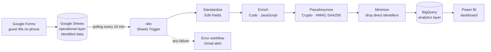

# Guest Check-in Data Pipeline — n8n → BigQuery → Power BI

> 🇧🇷 [Versão em português](README.pt-BR.md)

An automated workflow that turns a guest check-in form for a small hospitality business in Ubatuba (SP, Brazil) into an analytics-ready, privacy-compliant dataset — built with self-hosted **n8n**, **Google Sheets**, **BigQuery** and **Power BI**.

## The problem

Brazilian lodging businesses are legally required to register every guest. In small operations this usually lives on paper or in a loose spreadsheet: it satisfies the legal requirement, but never becomes insight about *who* the guests are, where they come from, why they travel and how far ahead they book.

This project automates the whole path — from the form the guest fills in on their phone to a dashboard — while keeping personal data out of the analytics layer.

## Architecture



## Pipeline steps

| # | Node | What it does |
|---|------|--------------|
| 1 | **Google Sheets Trigger** | Polls the form-responses sheet and emits only newly added rows. |
| 2 | **Standardize** (Edit Fields) | Renames columns to `snake_case`, converts `dd/MM/yyyy` dates to ISO, casts numbers and booleans, strips bilingual labels (`"Férias (Vacation)"` → `"Férias"`) and turns empty values into real `NULL`s. |
| 3 | **Enrich** (Code) | Derives age *at check-in date*, age band, nights, booking lead time, weekday and month of check-in, and a masked document for display. Null-safe for optional fields. |
| 4 | **Pseudonymize** (Crypto) | Generates `hospede_id` = HMAC-SHA256(document, secret key). Same guest → same ID, enabling returning-guest analysis without storing the document. |
| 5 | **Minimize** (Edit Fields) | Drops name, document, phone, birth date and masked document before anything leaves the operational layer. |
| 6 | **Insert rows** (BigQuery) | Auto-maps fields to a typed, date-partitioned table. |
| — | **Error workflow** | Separate workflow (`Error Trigger → Gmail`) fired on any failure, reporting the failing node, the error message and a link to the execution. |

## Design decisions

**Operational vs. analytical layers.** Identified data (name, document, phone) stays in the operational sheet, where the front desk needs it for the legal guest registry. BigQuery only receives a pseudonymous ID plus profile attributes — the LGPD principle of data minimization applied at pipeline level.

**HMAC instead of a plain hash.** A Brazilian CPF has a small key space, so a plain SHA-256 could be reversed by brute force (hash every possible CPF and compare). HMAC mixes in a secret key, so the IDs are useless without it. The key lives in n8n's credential vault, not in the workflow definition, so exporting or sharing the workflow does not leak it.

**Age at check-in date, not today.** Profile metrics stay historically correct: a 2026 stay keeps the guest's 2026 age when the dashboard is read years later.

**Optional fields handled explicitly.** Booking date is optional (many guests don't remember it). Every expression is null-safe and emits a real `NULL` instead of the string `"null"`, and derived metrics (lead time) are only computed when their inputs exist. Dashboards report averages together with the field's fill rate.

**Typed, partitioned table.** Explicit schema (`DATE`, `TIME`, `TIMESTAMP`, `INT64`, `BOOL`) and partitioning by `data_checkin`, so period filters scan only the relevant partitions.

**Least privilege and secret hygiene.** OAuth app kept in testing mode with an explicit test-user list; one scoped credential per integration; client secret rotated after setup; n8n MCP access left disabled because nothing needs it.

**Observability.** A dedicated error workflow means the pipeline never fails silently — e.g. an expired OAuth token surfaces as an email within minutes.

## Data model — `hospedagem.checkins`

| Column | Type | Description |
|--------|------|-------------|
| `hospede_id` | STRING | Pseudonymous guest ID (HMAC-SHA256) |
| `envio_em` | TIMESTAMP | Form submission time |
| `data_reserva` | DATE | Booking date (optional) |
| `data_checkin` / `data_checkout` | DATE | Stay dates (partition key: check-in) |
| `hora_chegada` | TIME | Arrival time |
| `num_hospedes` | INT64 | Party size |
| `idade` / `faixa_etaria` | INT64 / STRING | Age at check-in and age band |
| `sexo`, `nacionalidade`, `profissao` | STRING | Profile attributes |
| `uf_residencia`, `cidade_residencia` | STRING | Place of residence |
| `origem_cidade` | STRING | City the guest arrived from |
| `motivo_viagem`, `meio_transporte` | STRING | Trip purpose and transport mode |
| `primeira_vez_ubatuba` | BOOL | First visit to the destination |
| `noites` | INT64 | Length of stay |
| `antecedencia_reserva_dias` | INT64 | Booking lead time (null if booking date unknown) |
| `dia_semana_checkin`, `mes_checkin` | STRING | Seasonality helpers |
| `aceite_registro` | BOOL | Privacy notice acknowledged |
| `processado_em` | TIMESTAMP | Pipeline processing time |

## Repository structure

```
├── README.md / README.pt-BR.md
├── sql/
│   └── ddl_checkins.sql        # dataset + table definition
├── src/
│   ├── 01_standardize.json     # Edit Fields expressions (staging layer)
│   └── 02_enrich.js            # Code node (derived fields)
└── workflows/
    ├── checkin_pipeline.json   # n8n workflow export (no credentials)
    └── alerta_erros.json       # error-alert workflow export
```

## Running it

1. Start n8n self-hosted with Docker:
   ```bash
   docker run -it --rm --name n8n -p 5678:5678 -v n8n_data:/home/node/.n8n docker.n8n.io/n8nio/n8n
   ```
2. In Google Cloud: enable the Sheets, Drive, BigQuery and Gmail APIs; create an OAuth client (web app) with redirect URI `http://localhost:5678/rest/oauth2-credential/callback`; add your accounts as test users.
3. Run `sql/ddl_checkins.sql` in BigQuery (replace `your-project-id`).
4. Import the workflows from `workflows/`, create the credentials (Google Sheets Trigger, BigQuery, Gmail, Crypto/HMAC secret) and point the trigger to your form-responses sheet.
5. Set `alerta_erros` as the Error Workflow in the pipeline settings and publish.

## Limitations and next steps

- **Runs locally** — the pipeline only processes while the host machine is on (rows accumulate in the sheet and are picked up on restart). Next: move the container to an always-on VM.
- **Deduplication** — add a BigQuery view keyed on `hospede_id` + `data_checkin` to guard against reprocessing.
- **Consent granularity** — split a separate, refusable consent for analytical use from the mandatory registry notice, and filter on it in the pipeline.
- **Enrichment** — map city of residence to region and distance to the destination via the IBGE API.
- **Distribution** — automate sending a pre-filled form link per booking (email / WhatsApp Business API).
- **Power BI** — guest profile, origin, trip purpose, booking lead time, returning guests and seasonality *(in progress)*.
