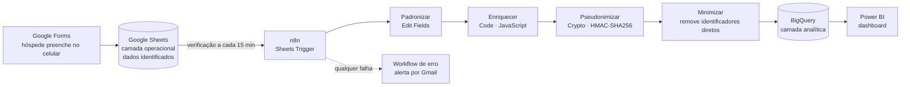

# Pipeline de Dados de Check-in de Hóspedes — n8n → BigQuery → Power BI

> 🇺🇸 [English version](README.md)

Workflow automatizado que transforma a ficha de check-in de uma hospedagem em Ubatuba (SP) em uma base analítica pronta para dashboard e em conformidade com a LGPD — construído com **n8n** self-hosted, **Google Sheets**, **BigQuery** e **Power BI**.

## O problema

Meios de hospedagem são obrigados por lei a registrar cada hóspede. Em operações pequenas, isso costuma ficar no papel ou numa planilha solta: cumpre a obrigação legal, mas nunca vira informação sobre *quem* são os hóspedes, de onde vêm, por que viajam e com quanta antecedência reservam.

O projeto automatiza todo o caminho — do formulário que o hóspede preenche no celular até o dashboard — mantendo os dados pessoais fora da camada analítica.

## Arquitetura

## Etapas do pipeline

| # | Nó | O que faz |
|---|----|-----------|
| 1 | **Google Sheets Trigger** | Verifica a planilha de respostas e emite apenas as linhas novas. |
| 2 | **Padronizar** (Edit Fields) | Renomeia colunas para `snake_case`, converte datas `dd/MM/yyyy` para ISO, tipa números e booleanos, remove as traduções (`"Férias (Vacation)"` → `"Férias"`) e transforma vazios em `NULL` real. |
| 3 | **Enriquecer** (Code) | Calcula idade *na data do check-in*, faixa etária, noites, antecedência da reserva, dia da semana e mês do check-in e o documento mascarado. Seguro contra campos opcionais vazios. |
| 4 | **Pseudonimizar** (Crypto) | Gera o `hospede_id` = HMAC-SHA256(documento, chave secreta). Mesmo hóspede → mesmo ID, permitindo analisar recorrência sem guardar o documento. |
| 5 | **Minimizar** (Edit Fields) | Remove nome, documento, telefone, data de nascimento e documento mascarado antes de qualquer dado sair da camada operacional. |
| 6 | **Insert rows** (BigQuery) | Mapeia os campos automaticamente para uma tabela tipada e particionada por data. |
| — | **Workflow de erro** | Fluxo separado (`Error Trigger → Gmail`) acionado em qualquer falha, informando o nó, a mensagem de erro e o link da execução. |

## Decisões de projeto

**Camada operacional vs. analítica.** Dados identificados (nome, documento, telefone) ficam na planilha operacional, onde a recepção precisa deles para o registro legal. O BigQuery recebe só um ID pseudonimizado e atributos de perfil — o princípio de minimização da LGPD aplicado no pipeline.

**HMAC em vez de hash simples.** O CPF tem um espaço de combinações pequeno, então um SHA-256 puro poderia ser revertido por força bruta. O HMAC usa uma chave secreta, tornando os IDs inúteis sem ela. A chave fica no cofre de credenciais do n8n, e não na definição do workflow.

**Idade na data do check-in.** As métricas de perfil continuam historicamente corretas quando o dashboard é consultado anos depois.

**Campos opcionais tratados explicitamente.** A data da reserva é opcional. Todas as expressões geram `NULL` real em vez do texto `"null"`, e métricas derivadas só são calculadas quando os dados de entrada existem. O dashboard mostra médias junto com a taxa de preenchimento do campo.

**Tabela tipada e particionada.** Esquema explícito e particionamento por `data_checkin`, para que filtros de período leiam só as partições necessárias.

**Menor privilégio e higiene de segredos.** App OAuth em modo de teste com lista explícita de usuários; uma credencial por integração; client secret rotacionado após a configuração; acesso MCP do n8n desativado por não ser necessário.

**Observabilidade.** Um workflow de erro dedicado garante que o pipeline nunca falhe em silêncio.

## Modelo de dados

Ver a tabela de colunas no [README em inglês](README.md#data-model--hospedagemcheckins) e o script em [`sql/ddl_checkins.sql`](sql/ddl_checkins.sql).

## Limitações e próximos passos

- **Execução local** — o pipeline só processa com a máquina ligada (as linhas acumulam na planilha e são processadas ao religar). Próximo passo: VM sempre ligada.
- **Deduplicação** — view no BigQuery por `hospede_id` + `data_checkin`.
- **Granularidade do consentimento** — separar um consentimento analítico recusável do aviso obrigatório de registro e filtrar no pipeline.
- **Enriquecimento** — região e distância até o destino via API do IBGE.
- **Distribuição** — envio automático do link pré-preenchido por reserva (e-mail / WhatsApp Business API).
- **Power BI** — perfil, origem, motivo da viagem, antecedência, recorrência e sazonalidade *(em andamento)*.
